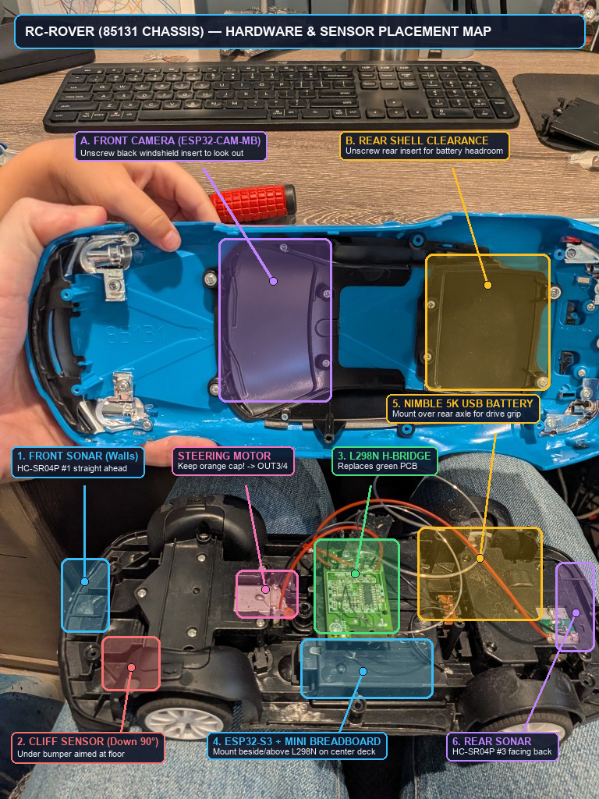

# Autonomous RC Rover (ESP32-S3 + ESP32-CAM-MB + L298N + Dual HC-SR04P)

Autonomous and Wi-Fi-teleoperated RC rover firmware built with PlatformIO and the Arduino framework targeting:
1. **Primary Rover Controller:** SANXIXING **ESP32-S3 DevKit (N16R8)** (`192.168.4.1`)
2. **Companion FPV Camera:** Aideepen **ESP32-CAM-MB (OV2640)** (`192.168.4.2:81/stream`)

See **[agent.md](agent.md)** for full hardware context, assembly notes, and state-machine architecture.



---

## Hardware Bill of Materials (BOM)

| Component | Description | Amazon Link |
| :--- | :--- | :--- |
| **ESP32-S3 DevKit N16R8 (3-Pack)** | Dual-Core 16MB Flash / 8MB PSRAM, Dual Type-C, 44 Pins | [https://a.co/d/06Lic7if](https://a.co/d/06Lic7if) |
| **Aideepen ESP32-CAM-MB (2-Pack)** | OV2640 2MP Wi-Fi Camera + `CH340G` Micro-USB Baseboard | [https://a.co/d/0dX22e7p](https://a.co/d/0dX22e7p) |
| **BOJACK L298N Motor Driver (4-Pack)** | Dual H-Bridge DC Motor Controller (`HW-095`) | [https://a.co/d/09Fo7jR4](https://a.co/d/09Fo7jR4) |
| **HC-SR04P Ultrasonic Sensor (2-Pack)** | `3V–5.5V` Wide Voltage, `2cm–450cm` Distance Sensor | [https://a.co/d/0goX3Ql8](https://a.co/d/0goX3Ql8) |
| **ELEGOO 120pcs Dupont Wire Kit** | `40-pin` Male-to-Female, Male-to-Male & Female-to-Female | [https://a.co/d/0frG2YbZ](https://a.co/d/0frG2YbZ) |
| **Chanzon SYB-170 Mini Breadboards** | `6-Pack` 170 Tie-Point Solderless Prototype Boards | [https://a.co/d/09p7nb25](https://a.co/d/09p7nb25) |

---

## 1. Hardware Pinout Mapping

| Component | Component Pin | ESP32-S3 Pin (`YD-ESP32-S3` 44-Pin) | Description |
| :--- | :--- | :--- | :--- |
| **L298N** | `12V` (Power In) | Car Switch (`+`) | 5× AA Battery power (`6.0V–7.5V`) |
| **L298N** | `GND` | Car Switch (`-`) & ESP32 `GND` (Left Pin 22) | **Mandatory shared common ground** |
| **L298N** | `OUT1` / `OUT2` | Rear Motor Leads A / B | 130-can rear traction DC motor |
| **L298N** | `OUT3` / `OUT4` | Front Steering Leads A / B | Spring-centered front steering actuator |
| **L298N** | `ENA` (🔵 **Blue**) | `GPIO 8` (Right column `8` on underside) | Rear motor PWM speed control *(remove jumper)* |
| **L298N** | `IN1` (🟢 **Green**) | `GPIO 4` (Right column `4` on underside) | Drive motor direction forward |
| **L298N** | `IN2` (🟡 **Yellow**) | `GPIO 5` (Right column `5` on underside) | Drive motor direction reverse |
| **L298N** | `IN3` (🟠 **Orange**) | `GPIO 6` (Right column `6` on underside) | Steering left command |
| **L298N** | `IN4` (🔴 **Red**) | `GPIO 7` (Right column `7` on underside) | Steering right command |
| **L298N** | `ENB` (🟤 **Brown**) | `GPIO 9` (Right column `9` on underside) | Steering PWM power cap *(remove jumper)* |
| **Front HC-SR04P** | `Vcc` (🟣 **Purple**) / `Gnd` (⚫ **Black**) | `3V3` (Top-Right Pin 1) / `GND` (Top-Left Pin 1) | Direct `F-F` jumper (underside view) |
| **Front HC-SR04P** | `Trig` (⚙️ **Gray**) | `GPIO 10` (Right column `10` on underside) | Front 10µs trigger pulse output |
| **Front HC-SR04P** | `Echo` (⚪ **White**) | `GPIO 11` (Right column `11` on underside) | Front echo pulse input (`28–65 cm` steer around) |
| **Rear HC-SR04P** | `Vcc` (🟣 **Purple**) / `Gnd` (⚫ **Black**) | `3V3` (Top-Right Pin 2) / `GND` (Bottom-Right Pin 22) | Direct `F-F` jumper (underside view) |
| **Rear HC-SR04P** | `Trig` (⚙️ **Gray**) | `GPIO 12` (Right column `12` on underside) | Rear 10µs trigger pulse output |
| **Rear HC-SR04P** | `Echo` (⚪ **White**) | `GPIO 13` (Right column `13` on underside) | Rear echo pulse input (`< 15 cm` reverse stop) |
| **Onboard RGB LED**| `WS2812` | `GPIO 48` (Onboard) | Green=Cruise, Amber=Steer, Red=Stop, Purple=Follow |
| **ESP32-CAM** | `3.3V` / `GND` | `3V3` (Top-Right Pin 1) / `GND` (Top-Left Pin 1) | Powered via `3.3V` & `GND` jumpers (with front sensor on mini breadboard) |

*(See [`docs/esp32_s3_pinout.jpg`](docs/esp32_s3_pinout.jpg), [`docs/l298n_pinout.jpg`](docs/l298n_pinout.jpg), [`docs/hcsr04p_pinout.jpg`](docs/hcsr04p_pinout.jpg), [`docs/esp32_cam_mb_pinout.jpg`](docs/esp32_cam_mb_pinout.jpg), [`docs/front_sensor_extension_wire_swaps.jpg`](docs/front_sensor_extension_wire_swaps.jpg), and [`docs/sensor_extension_wire_swaps.jpg`](docs/sensor_extension_wire_swaps.jpg) for exact board pinout & wire color diagrams.)*

### Proximity Sensor Extension Wire Color Swaps

#### 1. `Yellow – Orange – Red – Brown` Sensor Extension ([`docs/front_sensor_extension_wire_swaps.jpg`](docs/front_sensor_extension_wire_swaps.jpg))
| Signal | ESP32-S3 Wire Color | ➔ | Extension Wire Color | `HC-SR04P` Sensor Pin (Left → Right, Front View, Pins Down) |
| :--- | :--- | :---: | :--- | :--- |
| **`3V3` Power** | 🟣 **Purple** | ➔ | 🟡 **Yellow** | **`Vcc` (Pin 1 — Leftmost)** |
| **`Echo` Signal** | ⚪ **White** | ➔ | 🟠 **Orange** | **`Echo` (Pin 3 — 3rd from Left)** |
| **`Trig` Signal** | ⚙️ **Gray** | ➔ | 🔴 **Red** | **`Trig` (Pin 2 — 2nd from Left)** |
| **`GND` Ground** | ⚫ **Black** | ➔ | 🟤 **Brown** | **`Gnd` (Pin 4 — Rightmost)** |

#### 2. `Gray – Purple – Blue – Green` Sensor Extension ([`docs/sensor_extension_wire_swaps.jpg`](docs/sensor_extension_wire_swaps.jpg))
| Signal | ESP32-S3 Wire Color | ➔ | Extension Wire Color | `HC-SR04P` Sensor Pin (Left → Right, Front View, Pins Down) |
| :--- | :--- | :---: | :--- | :--- |
| **`3V3` Power** | 🟣 **Purple** | ➔ | ⚙️ **Gray** | **`Vcc` (Pin 1 — Leftmost)** |
| **`Trig` Signal** | ⚙️ **Gray** | ➔ | 🟣 **Purple** | **`Trig` (Pin 2 — 2nd from Left)** |
| **`Echo` Signal** | ⚪ **White** | ➔ | 🔵 **Blue** | **`Echo` (Pin 3 — 3rd from Left)** |
| **`GND` Ground** | ⚫ **Black** | ➔ | 🟢 **Green** | **`Gnd` (Pin 4 — Rightmost)** |

---

## 2. Firmware Architecture

- **[src/motor_controller.h](src/motor_controller.h) / [src/motor_controller.cpp](src/motor_controller.cpp)**:
  - Drives the L298N H-Bridge using ESP32 hardware LEDC PWM (`ledcAttach` on Arduino Core v3.x with automatic fallback for Core v2.x).
  - Caps front steering PWM at `200` (max `220`) to protect the 2-wire spring-centered steering actuator.
- **[src/sonar_driver.h](src/sonar_driver.h) / [src/sonar_driver.cpp](src/sonar_driver.cpp)**:
  - Non-blocking dual-channel interrupt-driven (`CHANGE` ISRs on `GPIO 11` and `GPIO 13`) ultrasonic driver alternating every `30ms` with 3-sample median filtering.
- **[src/web_interface.h](src/web_interface.h) / [src/web_interface.cpp](src/web_interface.cpp)**:
  - Simultaneously runs the `RC-Rover` SoftAP (`192.168.4.1`) and connects to home Wi-Fi (`rc-rover.local` / `10.1.1.162`) for wireless OTA updates and remote browser control.
  - Relays live JPEG frames from the `ESP32-CAM` (`192.168.4.2/capture`) over `/cam.jpg` so the camera overlay works seamlessly even when viewing the dashboard from home Wi-Fi without joining the `RC-Rover` hotspot.
  - Performs **Dual-Mode Camera + Sonar Sensor Fusion**:
    1. **Headless On-Chip Vision (Core 0 `analyzeFrameOnChip`):** Continuously decodes incoming `320×240` JPEGs at 1/8th scale (`40×30` RGB565) on the `ESP32-S3` at ~4 FPS, scans 16 vertical floor-horizon columns (`-30°` to `+30°`), calibrates them against the live Front Sonar centimeter distance, and feeds `Left` / `Right` optical clearances to the steering brain even when no browser is open.
    2. **Browser HUD Overlay & 2D Occupancy Heat Map:** Double-buffered 60 FPS `<canvas>` HUD with software rotation (`180°` default + live `Rot 90°` button), thermal obstacle occupancy grid, green explored free-space corridors, drivable floor-horizon polygon, and tap-to-lock visual target tracking.
- **[src/main.cpp](src/main.cpp)**:
  - **12-Sector (360°) World Map & Frontier Exploration:** Integrates steering odometry, front/rear sonar cones, and camera optical floor clearances (`45%` camera vision + `55%` sonar sector memory) to steer toward the widest unvisited open corridor.
  - **Auto Steer Mode:** Steers smoothly around obstacles (`< 38 cm`, resuming straight cruise at `>= 46 cm` with hysteresis), reverses for a full `1.5s` when blocked (`< 20 cm`, guarded by Rear Sonar), and includes a **Sonar Odometry Stall Detector** that automatically backs out if the rover snags on a low obstacle below the ultrasonic beam.
  - **Follow-Me Mode:** Steers toward the camera-locked target (`LEFT`/`CENTER`/`RIGHT`) and uses the Front & Rear sensors to hold a `30–50 cm` standoff distance.
  - **Manual D-Pad Mode:** 9-way touch pad with a `500ms` heartbeat failsafe watchdog.
- **[src/cam_main.cpp](src/cam_main.cpp)**:
  - Companion firmware for the **Aideepen ESP32-CAM-MB**. Disables brownout resets for `3.3V` jumper operation, power-cycles the `OV2640` via `GPIO 32` (`PWDN`) on boot, uses UXGA PSRAM double-buffering (`CAMERA_GRAB_LATEST`) downsampled to QVGA to eliminate DMA `FB-OVF` overflows, and serves both `/stream` (port `81`) and `/capture` + `/status` (port `80` with `Connection: close` and `lru_purge_enable`).
  - Built-in LED diagnostics: **1 top flash** on power-on, **2 top flashes + solid rear red LED (`GPIO 33`)** when connected to the `RC-Rover` Wi-Fi network.

---

## 3. Flashing Both Boards with PlatformIO

### Step A: Flash the ESP32-S3 Rover Controller
Plug the **SANXIXING ESP32-S3** into your computer via USB-C and run:
```powershell
pio run -e esp32-s3-devkitc-1 --target upload
```

### Step B: Flash the Aideepen ESP32-CAM-MB
Snap the **ESP32-CAM** onto its included **ESP32-CAM-MB USB programmer baseboard**, plug it into your computer via Micro-USB, and run:
```powershell
pio run -e esp32cam --target upload
```

### Step C: Drive!
1. Plug both the **ESP32-S3** and the **ESP32-CAM-MB** into your **Nimble CHAMP LITE 5K** dual-port USB battery pack.
2. Join the **`RC-Rover`** Wi-Fi network (password: **`rover1234`**) on your phone and open **`http://192.168.4.1`** in Safari.
3. The live camera stream and obstacle/target HUD will appear automatically at the top of the dashboard.
